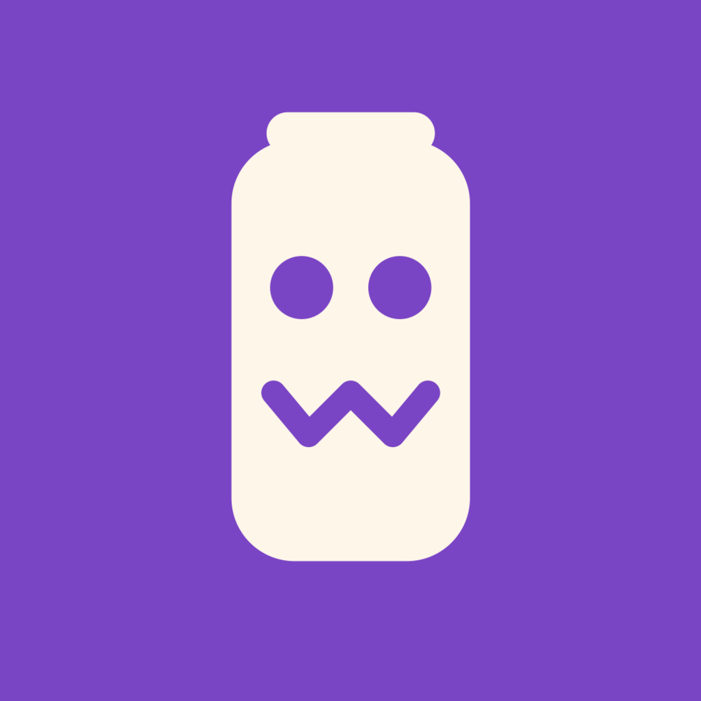
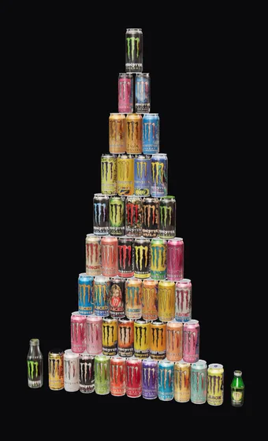
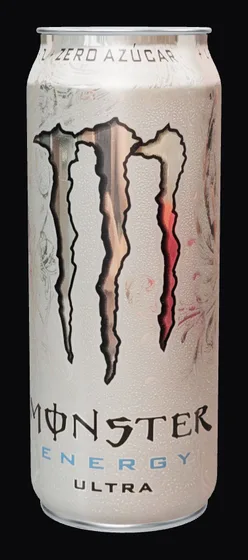

<div align="center">



# Ludok Monster

**An Android app to keep track of the Monster Energy cans you've tried.**

Which ones, how you rate them, where you bought them and for how much, with every can in 3D.<br>
No accounts, no servers: your data lives on your phone and is copied to your own Nextcloud.

[](LICENSE)
[](https://www.android.com/)
[](https://docs.expo.dev/versions/v57.0.0/)
[](https://reactnative.dev/)
[](https://www.typescriptlang.org/)
[](https://www.sqlite.org/)
[](https://threejs.org/)
[](https://www.blender.org/)

[Features](#features) · [Installation](#installation) · [Backups](#backups) · [Contributing](#contributing) · [License](#license)

</div>

---

> [!NOTE]
> **A free fan project.** Ludok Monster is not affiliated with, endorsed by or sponsored by Monster
> Energy Company. It's free, has no ads and accepts no payments or donations. "Monster Energy" and
> its can designs are trademarks of their owners. If the trademark owner asks, the app will be
> taken down.

<p align="center">
  
  &nbsp;&nbsp;
  
</p>

<p align="center"><sub>The app's 3D viewer: the full tower and the Ultra White.</sub></p>

## Table of Contents

- [Features](#features)
- [What Leaves Your Phone](#what-leaves-your-phone)
- [Installation](#installation)
- [Backups](#backups)
- [Development](#development)
- [The 3D Models](#the-3d-models)
- [Structure](#structure)
- [Design](#design)
- [Contributing](#contributing)
- [License](#license)

## Features

The catalog has **45 cans and 2 bottles**, modeled in Blender from six real photos of each one.
They aren't print textures: you may see reflections from the photos, and sizes are approximate per
format (500, 473, 444 and 355 ml), not measured for each can.

- **3D viewer**: spin and zoom each can with your fingers, offline.
- **Tried**: yes or no, with the date. Rating or commenting on a can marks it automatically.
- **Rating** from 1 to 10 and an optional comment.
- **Purchases**: price (EUR, USD, GBP, JPY, CHF or MXN), country and city. Several per can.
- **Tower**: the cans you've tried form a pyramid that grows as you try more. The "Colección"
  (collection) view shows the full tower, with the missing ones dimmed. Bottles stand on the floor,
  on both sides of the base.
- **Numbers**: how many you've tried from each range (Ultra, Juiced, Punch…), your average rating,
  your favorites, spending per currency, the most and least expensive, and the countries.
- **Map** of purchases with OpenStreetMap: one pin per city.
- In Ajustes (Settings), **"Marcar todas como probadas"** (mark all as tried) for people who
  already have the full collection.

The app's interface is in Spanish.

## What Leaves Your Phone

There is no Ludok Monster server and no analytics, but some features do talk to external services:

> **What does leave your phone:**
> - **Nominatim** (`nominatim.openstreetmap.org`): the city and country of a purchase, once per
>   city, to place it on the map. The result is stored and never requested again.
> - **OpenStreetMap** (`tile.openstreetmap.org`): the map tiles for the area you're looking at.
> - **unpkg** (`unpkg.com`): the Leaflet library for the map, when you open the map.
> - **Your Nextcloud**, if you turn on automatic backup: the whole backup, with your user and your
>   app password.

Your ratings, comments and prices are never sent to Nominatim or OpenStreetMap. The 3D viewer and
the rest of the app work offline.

## Installation

### From an APK

Download the APK from the [latest release](https://github.com/iamLudok/Ludok-monster/releases/latest)
and install it on your phone (Android will ask you to allow installing apps from that source).

### From source

You need Node 22, JDK 17, the Android SDK and `adb`.

```bash
git clone https://github.com/iamLudok/Ludok-monster.git
cd Ludok-monster
npm install
```

> **The textures aren't in the repository.** `public/` and `assets/miniaturas/` are photos of the
> cans, with Monster Energy's brand and design, so they aren't published. They're generated from
> the `../Monster` project (see [The 3D Models](#the-3d-models)); without them the app doesn't
> build.

```bash
npm run android        # with the phone connected over adb (USB debugging)
```

### Build the APK

```bash
npm run build:apk                    # all architectures
./scripts/build-apk.sh --compartir   # arm64-v8a only, for sharing with friends
# → android/app/build/outputs/apk/release/app-release.apk
adb install -r android/app/build/outputs/apk/release/app-release.apk
```

`release.jks` and `keystore.properties` sign the app and **are kept out of the repository**. If
they're lost, the only way to update the app on a phone is to uninstall it, and **uninstalling
deletes its data**. Keep them next to your backups.

## Backups

The rule is **never lose data**:

- Everything lives in SQLite, in the app's private storage. No servers, no accounts.
- **JSON backup** from Ajustes, through the system share menu.
- **Automatic backup to your own Nextcloud**: when you open the app, on WiFi only, at most every
  12 hours and one file per day (`ludok-monster-YYYY-MM-DD.json`).
- A warning in the can list if you've never backed up or haven't for a week.
- The Nextcloud password **never travels in backups** (see `src/types.ts`).
- The can catalog isn't in the database: it ships with the app. Your data links to it by each
  can's id, so a new version with more cans doesn't need any migration.

## Development

```bash
npm run verify     # backup round trip, rules and migrations, against a desktop SQLite
npm run typecheck
```

`verify/` runs the same code that runs on the phone against `@libsql/client`. It also checks that
every can in the catalog has its label, its HD version and its model in `public/`.

The app uses Expo SDK 57: check the docs for
[that exact version](https://docs.expo.dev/versions/v57.0.0/), not the latest.

## The 3D Models

All 45 cans share the same geometry, so there are only **four models** (one per tab type) in
`public/modelos/`, and the viewer gives each can its label, its lid and tab colors and its scale.
The bottles ("Botellas" range) don't share a shape: each one has its own full GLB.

Everything is generated from the Monster project, which has to be at `../Monster` (it's only read,
never modified):

```bash
npm run assets:modelos      # Blender: the 4 can GLBs
npm run assets:etiquetas    # Pillow: labels, HD versions, emblems and thumbnails
npm run assets:botellas     # Blender: the 2 bottles, each with its own GLB
python3 scripts/gen-assets.py   # app icons
```

The Blender commands use `blender` from your `PATH`. If it's somewhere else, point to it with
`BLENDER=/path/to/blender npm run assets:modelos`.

The viewer (`src/components/Visor3D.tsx`) is an Expo DOM Component with three.js: it runs in a
WebView and reads the files in `public/`, which are bundled in the APK.

## Structure

```
app/(tabs)/        Latas · Torre · Números · Ajustes (cans, tower, numbers, settings)
app/lata/[slug]    detail page: 3D viewer, tried, rating, comment and purchases
app/compra         add or edit a purchase
app/mapa           purchases map
src/lib/           data and rules (catalog, cans, prices, stats, tower, backup…)
src/components/    Visor3D and MapaComprasDom (DOM Components), warnings and Nextcloud
src/ui/            theme and primitives
public/            GLB models and labels for the WebView (generated, not in the repo)
assets/            icons, and list thumbnails (generated, not in the repo)
verify/            data layer checks
scripts/           Blender export, textures, icons and APK
```

## Design

"Sala oscura" (dark room), like the other Ludok apps: a monochrome interface with no accent color.
The cans bring the color. The ones you haven't tried are dimmed, both in the list and in the full
tower. The icon is a can with a face, without the Monster logo.

## Contributing

Pull requests are welcome. See [CONTRIBUTING.md](CONTRIBUTING.md) for the development setup and
conventions. To report a security vulnerability, follow [SECURITY.md](SECURITY.md) instead of
opening a public issue.

## License

The code is distributed under the **MIT License**. See [LICENSE](LICENSE) for the full text.

Ludok Monster is a personal fan project with no relation to Monster Energy Company. "Monster
Energy" and its can designs are trademarks of their owners and are not covered by the license.

---

<div align="center">

Made by [Luken Iriondo](https://github.com/iamLudok) · If Ludok Monster is useful to you, consider giving it a ⭐

🇪🇸 [En castellano](https://iamludok.github.io/ludok-apps-web/apps/monster/)

</div>
